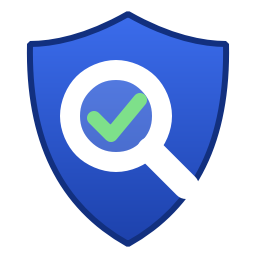
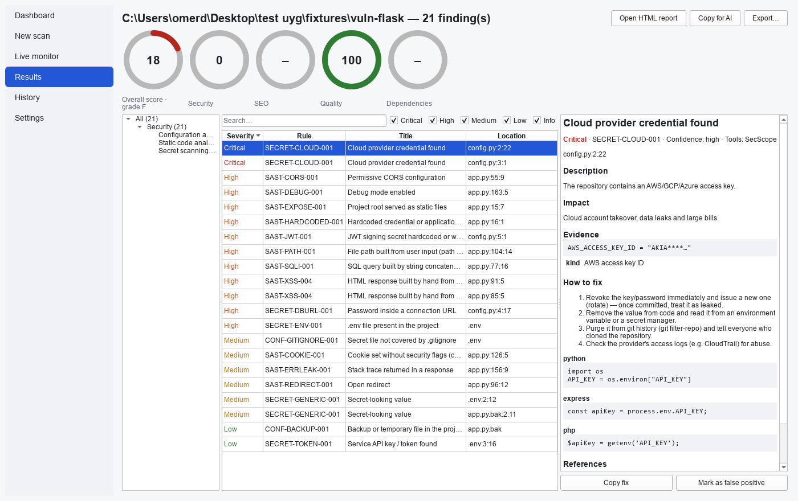
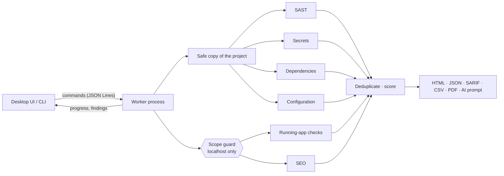

<p align="center">
  
</p>

<h1 align="center">SecScope</h1>

<p align="center">
  <b>Check your own web project for security holes, leaked secrets, vulnerable dependencies<br>
  and SEO problems — before you launch it. Locally, offline, with a fix for every finding.</b>
</p>

<p align="center">
  <a href="https://github.com/omer1916/secscope/actions/workflows/ci.yml"></a>
  <a href="LICENSE"></a>
  
  
  
</p>

<p align="center">
  <a href="README.tr.md">🇹🇷 Türkçe</a> ·
  <a href="docs/user-guide.en.md">User guide</a> ·
  <a href="#install">Install</a> ·
  <a href="docs/architecture.md">Architecture</a>
</p>

<p align="center">
  
</p>

---

## Why SecScope?

You built a web site or an app and are about to put it online. You want to know:
*Can someone read data they should not? Did I commit an API key? Do my packages have known
vulnerabilities? Will Google index it?*

SecScope answers those questions **on your own computer**. Your code never leaves the machine —
no account, no API key, no telemetry. Every finding says **what** is wrong, **where** (file and
line, or endpoint), **why** it matters, and **how to fix it**, with code for your stack.

## What it checks

| Area | Examples | How |
|---|---|---|
| **Code (SAST)** | SQL / NoSQL injection, XSS, command injection, SSRF, path traversal, open redirect, template injection, XXE, insecure deserialisation, weak crypto, JWT misuse, debug mode, permissive CORS, insecure defaults | Python AST taint tracking; pattern rules for JavaScript/TypeScript, PHP and templates; [Semgrep](https://semgrep.dev) and [Bandit](https://bandit.readthedocs.io) when available |
| **Secrets** | Cloud keys, API tokens, private keys, passwords in connection strings, committed `.env` files, secrets in git history | Own scanner (patterns + entropy) and [gitleaks](https://github.com/gitleaks/gitleaks); values are always masked |
| **Dependencies** | Known vulnerabilities (CVE/GHSA), typosquatting, install scripts, copyleft licences, CycloneDX SBOM | [Trivy](https://trivy.dev) and [osv-scanner](https://google.github.io/osv-scanner/) with **offline** databases; versions from lock files or the project's `.venv` |
| **Configuration** | Dockerfile & compose, nginx / Apache, GitHub Actions (pwn requests, expression injection, unpinned actions, token permissions), exposed backups and source maps | Own checks |
| **Running app** | Security headers, cookie flags, CORS, exposed `.git` / `.env`, stack-trace error pages; reflected XSS, template injection and open redirects verified with **harmless markers** | Ordinary requests to `localhost` only — no attack payloads |
| **SEO** | Indexability, `robots.txt`, sitemap, canonical URLs, titles & descriptions, structured data, mobile viewport, images, broken links | Googlebot-like crawl; generates `robots.txt`, `sitemap.xml` and JSON-LD drafts |

**116 rules**, each with an explanation, a fix with code, and CWE / OWASP Top 10:2025 / ASVS 5.0
references — see the [rule catalogue](docs/rules.md).

## Features

- 🖥️ **Desktop app** (packaged for Windows, runs from source on Linux and macOS) and a CLI; Turkish and English UI, light and dark theme.
- 🅰️ **One score, A–F**, from a [transparent formula](docs/scoring.md). Areas that were not measured are shown as "–", never as a free 100.
- 📄 **Reports**: offline single-file HTML, JSON, **SARIF** (GitHub code scanning, IDEs), CSV, and PDF (with the optional Playwright).
- 🤖 **Copy for AI**: one click copies every finding — code, explanation and suggested fix — as a Markdown prompt you can paste into ChatGPT or Claude to get it fixed.
- 🔁 **History and diff**: new, fixed and regressed findings between two scans; mark false positives with a reason.
- 🧭 **Attack-surface inventory**: Flask, FastAPI, Express and Django routes, with state-changing endpoints that have no visible authorisation check highlighted.
- ⚙️ **CI friendly**: `--fail-on high`, `--changed-since origin/main` (only changed files), SARIF output.
- 📊 **Honest coverage**: the report lists what was examined and what was set aside (excluded paths, dependency folders), and test / fixture code is shown separately.

## Safe by design

SecScope is meant for **your own** projects, and it is built so it cannot be pointed at anyone else's:

- **Scope guard** — every dynamic request goes through a guard that only allows `localhost`,
  `127.0.0.0/8` and `::1`. There is no setting to turn it off. DNS rebinding, redirects to other
  hosts and URL-parser tricks (`localhost@evil.com`, `0x7f000001`, …) are blocked and covered by
  [attack tests](tests/unit/test_scope_guard.py).
- **No attack payloads** — dynamic checks use ordinary requests and inert markers; forms are
  never submitted. Running-app checks only start after you confirm *"this system is mine"*.
- **Your files stay untouched** — the project is scanned and run from a copy; installed
  dependency folders (`.venv`, `node_modules`) are never copied; report folders are git-ignored.
- **Private** — no telemetry; external tools are downloaded only when you ask, pinned by version
  and SHA-256. See the [threat model](docs/threat-model.md).

## Install

### Windows (packaged)

1. Download `SecScope-<version>-win64.zip` from [**Releases**](https://github.com/omer1916/secscope/releases).
2. Unzip it anywhere and run **`SecScopeApp.exe`**.

> The build is not code-signed yet, so Windows SmartScreen may warn on first start:
> **More info → Run anyway**.

### From source (Windows, Linux, macOS)

Requires Python 3.12+ and [uv](https://docs.astral.sh/uv/).

```bash
git clone https://github.com/omer1916/secscope.git
cd secscope
uv sync
uv run secscope-gui      # desktop app
uv run secscope --help   # command line
```

### Optional tools (more coverage)

SecScope always works with its built-in engines. These add depth, and are verified by SHA-256:

```bash
secscope tools install gitleaks trivy osv-scanner   # secrets in git history, dependency CVEs
secscope tools update-db                            # offline vulnerability databases
uv tool install semgrep                             # extra code rules
```

## Quick start

**Desktop:** *New scan* → choose your project folder → (for SEO and running-app checks) tick
*"This system is mine"* → *Start scan*.

**Command line:**

```bash
# Code, secrets, dependencies and configuration
secscope scan --path ./my-project --format html,sarif

# + SEO and running-app checks (SecScope starts the app on localhost)
secscope scan --path ./my-site --accept-scope-statement

# In CI: only files changed in this pull request, fail on high severity
secscope scan --path . --changed-since origin/main --fail-on high

# Turn the findings of a scan into a prompt for an AI assistant
secscope report <scan-id> --format ai
```

## How accurate is it?

| Benchmark | Result |
|---|---|
| Expected findings in the bundled vulnerable apps (Flask, Express, PHP) | **36 / 36** found |
| False positives on the clean apps | **0** |
| SEO problems on the "bad" demo site / findings on the "good" one | **24 / 24** / **0** |
| SecScope scanning its own source (part of the test suite) | no medium+ findings |

SecScope was also tried on real projects; every false positive found there (for example
installed packages in `.venv` being scanned, `pyproject.toml` dependencies not being read, or
constant SQL fragments looking like injection) was fixed with a regression test. Details:
[benchmarks](docs/benchmarks.md).

**Honest limits:** pattern rules for JavaScript and PHP cannot follow data flow the way the
Python engine does; business-logic flaws (who may do what) need a human or an AI review — that is
what *Copy for AI* is for. Weaponised exploitation and load testing are deliberately out of scope
([ADR-009](docs/decisions/009-scope-of-this-build.md), [ADR-011](docs/decisions/011-benign-dynamic-checks.md)).

## How it works



The UI never blocks: scans run in a separate worker process that can be cancelled at any time
(its whole process tree is stopped). More in [architecture](docs/architecture.md) and the
[decision records](docs/decisions/).

## Documentation

| | |
|---|---|
| [User guide (English)](docs/user-guide.en.md) · [Kullanıcı kılavuzu (Türkçe)](docs/user-guide.tr.md) | Installing, first scan, reading results, CLI and CI |
| [Rule catalogue](docs/rules.md) · [OWASP mapping](docs/owasp-mapping.md) | Every rule with severity and references |
| [Scoring](docs/scoring.md) | How the A–F grade is computed |
| [Threat model](docs/threat-model.md) | How SecScope protects you from the code it scans |
| [Architecture](docs/architecture.md) · [Adding a module](docs/adding-a-module.md) | For contributors |
| [Packaging](packaging/README.md) | Building the Windows app |

## Development

```bash
uv sync
uv run pytest -m "not network"                                     # ~785 tests
uv run ruff format --check . && uv run ruff check . && uv run pyright   # strict typing
uv run pyinstaller packaging/pyinstaller.spec --noconfirm          # Windows build
```

Install the git hooks once with `uv run pre-commit install`. A new scanner is one file plus one
line in the module registry — see [adding a module](docs/adding-a-module.md).

## License

[Apache-2.0](LICENSE). External tools (Trivy, gitleaks, osv-scanner, Semgrep) keep their own
licences and are downloaded separately — see [ADR-003](docs/decisions/003-third-party-licenses.md).
