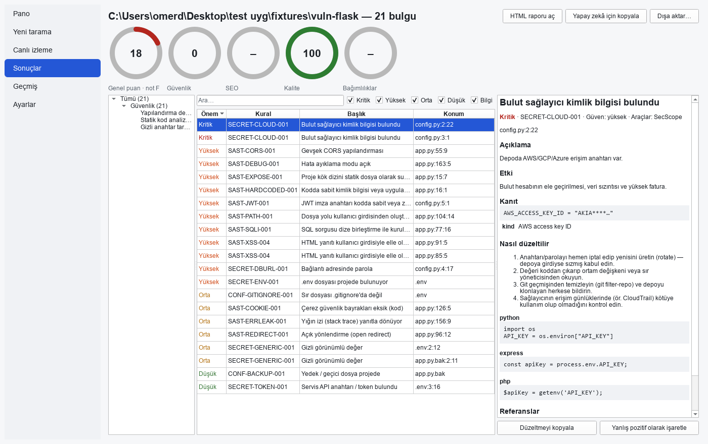
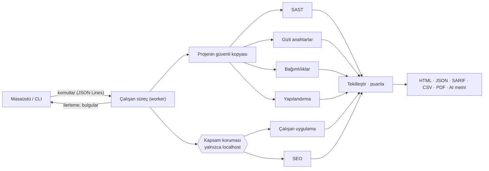

<p align="center">
  
</p>

<h1 align="center">SecScope</h1>

<p align="center">
  <b>Kendi web projeni yayına almadan önce güvenlik açıkları, sızmış anahtarlar, açıklı bağımlılıklar<br>
  ve SEO sorunları için tara. Kendi bilgisayarında, çevrimdışı, her bulgu için bir düzeltmeyle.</b>
</p>

<p align="center">
  <a href="https://github.com/omer1916/secscope/actions/workflows/ci.yml"></a>
  <a href="LICENSE"></a>
  
  
  
</p>

<p align="center">
  <a href="README.md">🇬🇧 English</a> ·
  <a href="docs/user-guide.tr.md">Kullanıcı kılavuzu</a> ·
  <a href="#kurulum">Kurulum</a> ·
  <a href="docs/architecture.md">Mimari</a>
</p>

<p align="center">
  
</p>

---

## Neden SecScope?

Bir web sitesi ya da uygulama yaptın ve yayına almak üzeresin. Şunları bilmek istiyorsun:
*Biri görmemesi gereken veriyi okuyabilir mi? Bir API anahtarını yanlışlıkla commit'ledim mi?
Kullandığım paketlerde bilinen açık var mı? Google siteyi dizine ekleyebilecek mi?*

SecScope bu soruları **kendi bilgisayarında** yanıtlar. Kodun makineden çıkmaz: hesap yok, API
anahtarı yok, telemetri yok. Her bulgu sorunun **ne** olduğunu, **nerede** olduğunu (dosya ve
satır ya da uç nokta), **neden** önemli olduğunu ve **nasıl düzeltileceğini** senin kullandığın
dile göre hazır kodla söyler.

## Neleri kontrol eder?

| Alan | Örnekler | Nasıl |
|---|---|---|
| **Kod (SAST)** | SQL / NoSQL enjeksiyonu, XSS, komut enjeksiyonu, SSRF, path traversal, açık yönlendirme, şablon enjeksiyonu, XXE, güvensiz serileştirme, zayıf şifreleme, JWT hataları, debug modu, gevşek CORS, güvensiz varsayılanlar | Python için veri akışı (taint) analizi; JavaScript/TypeScript, PHP ve şablonlar için desen kuralları; kuruluysa [Semgrep](https://semgrep.dev) ve [Bandit](https://bandit.readthedocs.io) |
| **Gizli anahtarlar** | Bulut anahtarları, API token'ları, özel anahtarlar, bağlantı adresindeki parolalar, commit'lenmiş `.env`, git geçmişindeki sırlar | Kendi tarayıcımız (desen + entropi) ve [gitleaks](https://github.com/gitleaks/gitleaks); değerler her zaman maskelenir |
| **Bağımlılıklar** | Bilinen açıklar (CVE/GHSA), typosquatting, kurulum betikleri, copyleft lisanslar, CycloneDX SBOM | **Çevrimdışı** veritabanlarıyla [Trivy](https://trivy.dev) ve [osv-scanner](https://google.github.io/osv-scanner/); sürümler kilit dosyalarından ya da projenin `.venv`'inden |
| **Yapılandırma** | Dockerfile ve compose, nginx / Apache, GitHub Actions (pwn request, ifade enjeksiyonu, sabitlenmemiş action'lar, token izinleri), açıkta kalan yedekler ve source map'ler | Kendi kontrollerimiz |
| **Çalışan uygulama** | Güvenlik başlıkları, çerez bayrakları, CORS, açıkta kalan `.git` / `.env`, yığın izi sızdıran hata sayfaları; yansıyan XSS, şablon enjeksiyonu ve açık yönlendirme **zararsız işaretlerle** doğrulanır | Yalnızca `localhost`'a normal istekler; saldırı yükü yok |
| **SEO** | Dizine eklenebilirlik, `robots.txt`, sitemap, canonical, başlık ve açıklamalar, yapısal veri, mobil görünüm, görseller, kırık bağlantılar | Googlebot benzeri tarama; `robots.txt`, `sitemap.xml` ve JSON-LD taslakları üretir |

**116 kural** var. Her biri açıklama, kodlu düzeltme ve CWE / OWASP Top 10:2025 / ASVS 5.0
referanslarıyla geliyor; tam liste [kural kataloğunda](docs/rules.md).

## Özellikler

- 🖥️ **Masaüstü uygulaması** (Windows için paketli; Linux ve macOS'ta kaynak koddan çalışır) ve komut satırı. Türkçe ve İngilizce arayüz, açık ve koyu tema.
- 🅰️ [Şeffaf bir formülle](docs/scoring.md) hesaplanan **tek bir not (A–F)**. Ölçülmeyen alanlar "–" olarak gösterilir, asla bedava 100 verilmez.
- 📄 **Raporlar**: çevrimdışı tek dosyalık HTML, JSON, **SARIF** (GitHub code scanning, IDE'ler), CSV ve PDF (isteğe bağlı Playwright ile).
- 🤖 **Yapay zekâ için kopyala**: tek tıkla tüm bulgular (kod, açıklama ve düzeltme önerisi) Markdown metni olarak kopyalanır. ChatGPT'ye ya da Claude'a yapıştırıp düzelttirebilirsin.
- 🔁 **Geçmiş ve karşılaştırma**: iki tarama arasında yeni, düzelen ve kötüleşen bulgular; yanlış pozitifleri gerekçesiyle işaretleme.
- 🧭 **Saldırı yüzeyi envanteri**: Flask, FastAPI, Express ve Django rotaları; veri değiştiren ama görünür yetki kontrolü olmayan uç noktalar vurgulanır.
- ⚙️ **CI uyumlu**: `--fail-on high`, `--changed-since origin/main` (yalnızca değişen dosyalar), SARIF çıktısı.
- 📊 **Dürüst kapsam**: rapor neyin incelendiğini ve neyin dışarıda bırakıldığını (hariç tutulan yollar, bağımlılık klasörleri) yazar; test ve fixture kodu ayrı gösterilir.

## Güvenli tasarım

SecScope **kendi** projelerin içindir ve başkasının sistemine yöneltilemeyecek şekilde yapılmıştır:

- **Kapsam koruması**: her dinamik istek yalnızca `localhost`, `127.0.0.0/8` ve `::1`'e izin veren
  bir korumadan geçer, kapatılamaz. DNS rebinding, başka sunuculara yönlendirme ve URL ayrıştırma
  hileleri (`localhost@evil.com`, `0x7f000001` gibi) engellenir ve
  [saldırı testleriyle](tests/unit/test_scope_guard.py) doğrulanır.
- **Saldırı yükü yok**: dinamik kontroller normal istekler ve zararsız işaretler kullanır, formlar
  asla gönderilmez. Çalışan uygulama kontrolleri ancak *"Bu sistem bana aittir"* onayından sonra başlar.
- **Dosyalarına dokunulmaz**: proje bir kopya üzerinde taranır ve çalıştırılır; kurulu bağımlılık
  klasörleri (`.venv`, `node_modules`) kopyalanmaz; rapor klasörleri git'e girmez.
- **Gizlilik**: telemetri yok. Harici araçlar yalnızca sen istediğinde indirilir ve sürüm ile
  SHA-256 değerine göre doğrulanır. Ayrıntılar [tehdit modelinde](docs/threat-model.md).

## Kurulum

### Windows (paketli)

1. [**Releases**](https://github.com/omer1916/secscope/releases) sayfasından `SecScope-<sürüm>-win64.zip` dosyasını indir.
2. İstediğin yere çıkar ve **`SecScopeApp.exe`**'yi çalıştır.

> Derleme henüz dijital imzalı değil. İlk açılışta Windows SmartScreen uyarı verebilir:
> **Ek bilgi → Yine de çalıştır**.

### Kaynak koddan (Windows, Linux, macOS)

Python 3.12+ ve [uv](https://docs.astral.sh/uv/) gerekir.

```bash
git clone https://github.com/omer1916/secscope.git
cd secscope
uv sync
uv run secscope-gui      # masaüstü uygulaması
uv run secscope --help   # komut satırı
```

### İsteğe bağlı araçlar (daha geniş kapsam)

SecScope kendi motorlarıyla her zaman çalışır. Bu araçlar kapsamı genişletir ve SHA-256 ile doğrulanarak kurulur:

```bash
secscope tools install gitleaks trivy osv-scanner   # git geçmişindeki sırlar, bağımlılık açıkları
secscope tools update-db                            # çevrimdışı açık veritabanları
uv tool install semgrep                             # ek kod kuralları
```

## Hızlı başlangıç

**Masaüstü:** *Yeni tarama* → proje klasörünü seç → (SEO ve çalışan uygulama kontrolleri için)
*"Bu sistem bana aittir"* kutusunu işaretle → *Taramayı başlat*.

**Komut satırı:**

```bash
# Kod, gizli anahtarlar, bağımlılıklar ve yapılandırma
secscope scan --path ./projem --format html,sarif

# + SEO ve çalışan uygulama kontrolleri (SecScope uygulamayı localhost'ta başlatır)
secscope scan --path ./sitem --accept-scope-statement

# CI'da: yalnızca bu pull request'te değişen dosyalar, yüksek önemde bulgu varsa başarısız ol
secscope scan --path . --changed-since origin/main --fail-on high

# Bir taramanın bulgularını yapay zekâ için metne çevir
secscope report <tarama-id> --format ai
```

## Ne kadar doğru çalışıyor?

| Ölçüm | Sonuç |
|---|---|
| Hazır savunmasız uygulamalardaki beklenen bulgular (Flask, Express, PHP) | **36 / 36** bulundu |
| Temiz uygulamalarda yanlış pozitif | **0** |
| "Kötü" örnek sitedeki SEO sorunları / "iyi" sitedeki bulgular | **24 / 24** / **0** |
| SecScope'un kendi kaynak kodunu taraması (test paketinin parçası) | orta ve üstü bulgu yok |

SecScope gerçek projelerde de denendi. Orada çıkan her yanlış pozitif regresyon testiyle birlikte
düzeltildi: `.venv` içindeki paketlerin taranması, `pyproject.toml` bağımlılıklarının okunmaması,
sabit SQL parçalarının enjeksiyon sanılması gibi. Ayrıntılar [ölçüm belgesinde](docs/benchmarks.md).

**Sınırlar:** JavaScript ve PHP için desen kuralları, Python motoru gibi veri akışını izleyemez.
İş mantığı hataları (kim neyi yapabilir) bir insan ya da yapay zekâ incelemesi gerektirir;
*Yapay zekâ için kopyala* bunun için var. Gerçek istismar denemesi ve yük testi bilerek kapsam
dışında ([ADR-009](docs/decisions/009-scope-of-this-build.md), [ADR-011](docs/decisions/011-benign-dynamic-checks.md)).

## Nasıl çalışır?



Arayüz hiç donmaz: taramalar ayrı bir süreçte çalışır ve her an iptal edilebilir (tüm süreç ağacı
durdurulur). Ayrıntılar [mimari belgesinde](docs/architecture.md) ve
[karar kayıtlarında](docs/decisions/).

## Belgeler

| | |
|---|---|
| [Kullanıcı kılavuzu (Türkçe)](docs/user-guide.tr.md) · [User guide (English)](docs/user-guide.en.md) | Kurulum, ilk tarama, sonuçları okuma, CLI ve CI |
| [Kural kataloğu](docs/rules.md) · [OWASP eşlemesi](docs/owasp-mapping.md) | Her kural, önem derecesi ve referanslarıyla |
| [Puanlama](docs/scoring.md) | A–F notunun nasıl hesaplandığı |
| [Tehdit modeli](docs/threat-model.md) | SecScope'un taradığı koda karşı seni nasıl koruduğu |
| [Mimari](docs/architecture.md) · [Modül ekleme](docs/adding-a-module.md) | Katkıda bulunmak isteyenler için |
| [Paketleme](packaging/README.md) | Windows uygulamasını derleme |

## Geliştirme

```bash
uv sync
uv run pytest -m "not network"                                     # ~785 test
uv run ruff format --check . && uv run ruff check . && uv run pyright   # katı tip denetimi
uv run pyinstaller packaging/pyinstaller.spec --noconfirm          # Windows derlemesi
```

Git kancalarını bir kez `uv run pre-commit install` ile kur. Yeni bir tarayıcı eklemek bir dosya
ve modül kaydına bir satırdan ibaret; bkz. [modül ekleme](docs/adding-a-module.md).

## Lisans

[Apache-2.0](LICENSE). Harici araçlar (Trivy, gitleaks, osv-scanner, Semgrep) kendi lisanslarına
tabidir ve ayrıca indirilir; bkz. [ADR-003](docs/decisions/003-third-party-licenses.md).
